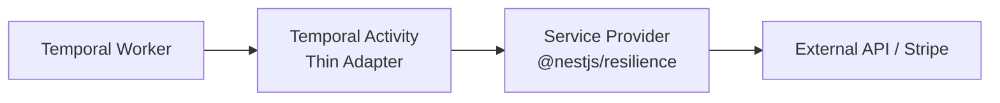

# Resilience & Fault Tolerance Conventions

To ensure system stability and graceful degradation, services interacting with external APIs (Stripe, shipping carriers, external microservices) or critical operations MUST adhere to the resilience layering patterns.

## 🛡 Architectural Separation: Service vs Activity

1. **Domain & Resilience in Service Layer**:
   - Resilience policies (`@CircuitBreaker`) belong in the service layer (`<service-name>.service.ts`) using `@nestjs/resilience` (`ResilienceService` presets or method decorators).
   - The service handles all external SDK calls, idempotency checks, database transactions, and error classification.

2. **Temporal Activity as Thin Adapter**:
   - Temporal Activity classes (`<action>.activity.ts`) remain lightweight adapters implementing the activity interface from `@libs/temporal`.
   - Activities delegate execution directly to the service provider.



---

## 🎯 One Job per Layer

| Layer                      | Owns                                                              | Configuration                                               |
| :------------------------- | :---------------------------------------------------------------- | :---------------------------------------------------------- |
| External SDK (e.g. Stripe) | Single request + request timeout                                  | `maxNetworkRetries: 0`, explicit `timeout`                  |
| `@nestjs/resilience`       | Circuit breaker only (shared across all workflows in the process) | Preset with `circuitBreaker` only, NO `retry`, NO `timeout` |
| Service `catch`            | Error classification for Temporal                                 | `ApplicationFailure`                                        |
| Temporal                   | All retries                                                       | `proxyActivities` retry policy                              |

---

## ⚡ Configuration Patterns

### 1. External SDK Client (Stripe)

```typescript
StripeModule.forRootAsync({
  inject: [ConfigService],
  useFactory: (configService: ConfigService): StripeModuleConfig => ({
    apiKey: configService.getOrThrow<string>('STRIPE_SECRET_KEY'),
    appInfo: {
      name: 'nest-microservices-temporal',
      version: '0.0.1',
    },
    maxNetworkRetries: 0, // Temporal owns retries; one request per call so the circuit breaker counts every failure
    timeout: 9000, // Only per-request timeout; keep well below the activity startToCloseTimeout (30s)
  }),
}),
```

### 2. Resilience Preset (`ResilienceModule.forRoot`)

```typescript
ResilienceModule.forRoot({
  presets: {
    [ResiliencePreset.STRIPE_PAYMENT_GATEWAY]: {
      circuitBreaker: {
        name: 'stripe-circuit-breaker',
        failureRateThreshold: 50, // Trip open if failure rate reaches >= 50%
        minimumCalls: 5, // Minimum requests required before calculating failure rate
        openDuration: '30s', // Cooldown duration in Open state before testing recovery
        halfOpenMaxCalls: 1, // Single probe request allowed in Half-Open state
      },
      /**
       * No retry/timeout here: Temporal owns retries, the Stripe SDK owns the request timeout.
       */
    },
  },
}),
```

> [!NOTE]
> The circuit breaker ignores 4xx client errors (except 408 timeout and 429 rate limit) via `isClientError()`, and never counts `CircuitOpenError` rejections toward the failure rate.

---

## 🛑 Error Classification

| Error Type                                                              | Behavior                                          | Temporal Handling                                                                                         |
| :---------------------------------------------------------------------- | :------------------------------------------------ | :-------------------------------------------------------------------------------------------------------- |
| `CircuitOpenError`                                                      | Circuit is open; request never reached provider   | `ApplicationFailure.create` with `nextRetryDelay: error.retryAfterMs` (retry delayed until probe allowed) |
| Client / Business Errors (`isStripeClientError`, `BadRequestException`) | Card declined, invalid parameters, payment failed | `ApplicationFailure.nonRetryable` (fail fast, trigger saga compensation immediately)                      |
| Transient Errors (5xx, network, DB)                                     | Downstream outage, network drop                   | Rethrown as standard Error; Temporal retries using backoff                                                |

### `chargePayment` Catch Implementation

```typescript
    } catch (error) {
      // Circuit breaker is open: the request never reached Stripe.
      // Ask Temporal to retry exactly when the breaker lets a probe call through.
      if (error instanceof CircuitOpenError) {
        this.logger.error(
          `[Order ${orderId}] Stripe circuit breaker is OPEN. Temporal will retry in ${error.retryAfterMs}ms.`,
        );

        throw ApplicationFailure.create({
          message: `Stripe service is temporarily unavailable (Circuit Breaker). Retry after ${error.retryAfterMs}ms`,
          type: CircuitOpenError.name,
          nextRetryDelay: error.retryAfterMs,
          cause: error,
        });
      }

      // Business errors (card declined, invalid request, payment not succeeded) never fix themselves.
      if (this.isStripeClientError(error) || error instanceof BadRequestException) {
        this.logger.error(`[Order ${orderId}] Payment rejected, will not retry: ${error.message}`);

        throw ApplicationFailure.nonRetryable(
          error.message,
          error instanceof Stripe.errors.StripeError ? error.type : error.name,
        );
      }

      // Transient errors (Stripe 5xx, network, DB): let Temporal retry with its backoff.
      this.logger.error(
        `[Order ${orderId}] Failed to charge payment: ${error instanceof Error ? error.message : 'Unknown error'}`,
      );

      throw error;
    }
```

> [!NOTE]
> For Stripe errors, use `error.type` (e.g. `StripeCardError`) because `error.name` on Stripe errors is generic `"Error"`.

---

## 🔄 Temporal Retry Strategy

- **Forward steps**: bounded retries (e.g., 3 attempts, 1s initial interval, backoff coefficient 2). If all attempts fail or a non-retryable failure occurs, the workflow terminates forward progress and begins compensation.
- **Compensation steps**: unbounded retries with a long schedule timeout (`scheduleToCloseTimeout: '24 hours'`, `maximumInterval: '2 minutes'`) to guarantee eventual consistency.

```typescript
// Charge: limited retries, then the saga gives up and compensates.
// Card declined is non-retryable; an open circuit breaker delays the next retry via nextRetryDelay.
const paymentChargeActivities: ActivityInterfaceFor<{
  chargePayment: IChargePaymentActivity['execute'];
}> = proxyActivities({
  startToCloseTimeout: '30 seconds',
  taskQueue: WorkFlowTaskQueue.PAYMENT,
  retry: {
    maximumAttempts: 3,
    backoffCoefficient: 2,
    initialInterval: '1 second',
  },
});

// Refund (compensation): must eventually succeed, so retry without an attempt limit for up to 24 hours.
const paymentRefundActivities: ActivityInterfaceFor<{
  refundPayment: IRefundPaymentActivity['execute'];
}> = proxyActivities({
  taskQueue: WorkFlowTaskQueue.PAYMENT,
  startToCloseTimeout: '30 seconds',
  scheduleToCloseTimeout: '24 hours',
  retry: {
    initialInterval: '5 seconds',
    backoffCoefficient: 2,
    maximumInterval: '2 minutes',
  },
});
```

---

> [!CRITICAL]
> **Timeout Constraint**: The external SDK timeout (e.g., Stripe 9s) plus local service work must be **strictly less** than the Temporal Activity's `startToCloseTimeout` (30s). If an activity execution exceeds `startToCloseTimeout`, Temporal aborts the activity task.

> [!NOTE]
> A retry delayed by `nextRetryDelay` still counts toward `maximumAttempts`. The circuit breaker state is maintained in-memory per process worker.
